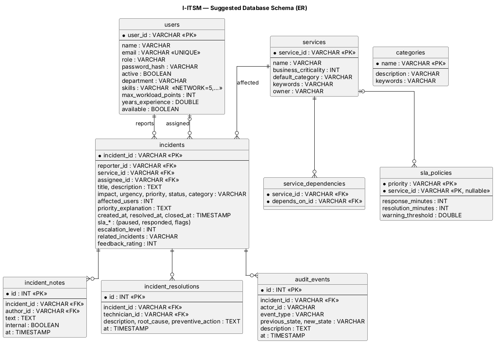

# I-ITSM — Database Design (for Member 3)



## How persistence works

The domain uses a **write-through** design:

1. Live objects stay in memory (fast, and all business rules run on them).
2. Every change is immediately saved through **one interface, `StorageAdapter`**.
3. At startup, `desk.attachStorage(adapter)` loads everything back and rebuilds technician workloads from the open incidents, so they can never drift out of sync.

Member 3 only writes **one class** that implements `StorageAdapter`. The domain gives you plain-data records to save:

| Domain object | Record to save | Rebuild with |
|---|---|---|
| `User` (all roles) | `UserRecord.from(user)` | `record.toUser()` (done for you by `attachStorage`) |
| `Incident` | `incident.toRecord()` → `IncidentRecord` | `Incident.restore(...)` (done for you) |
| `ITService` | `ServiceRecord.from(service)` | done for you |
| Audit event | `DomainEvent` (already plain data) | done for you |
| `Category`, `SLAPolicy` | already plain | done for you |

Passwords are stored as a salted PBKDF2 hash string (`"salt:hash"` in Base64, column `password_hash`), never in plain text. Small collections (skills, keywords, related incidents) fit in one text column using `Codec`, e.g. `"NETWORK=5,HARDWARE=3"`.

## Startup code (Spring Boot)

```java
@Bean
ServiceDesk serviceDesk(JdbcStorageAdapter db) {
    ServiceDesk desk = new ServiceDesk(Clock.system());
    desk.attachStorage(db);                 // reload everything saved
    if (desk.isEmpty()) SampleData.seed(desk);   // first run: create demo organisation
    return desk;
}
```

## Skeleton to fill in

```java
public class JdbcStorageAdapter implements StorageAdapter {
    private final DataSource ds;

    @Override public void saveIncident(IncidentRecord r) {
        try (Connection c = ds.getConnection()) {
            // 1. UPSERT into incidents (one column per scalar field of r)
            // 2. DELETE + INSERT incident_notes for r.notes()
            // 3. DELETE + INSERT incident_resolutions for r.resolutions()
        } catch (SQLException e) {
            throw new PersistenceException("Could not save " + r.incidentId(), e);   // → HTTP 503
        }
    }
    // saveUser / loadUsers / loadIncidents / saveService / loadServices / saveAuditEvent ...
}
```

`InMemoryStorage` (in `domain/persistence`) is a complete working example of every method, and the test `everythingSurvivesARestart` shows the full save → restart → reload cycle. Run the same test against your JDBC adapter to prove it works.

## Tables

| Table | Key columns | Notes |
|---|---|---|
| `users` | `user_id` PK, `email` UNIQUE | `role` decides which class is rebuilt; technician fields are NULL for other roles |
| `services` | `service_id` PK | |
| `service_dependencies` | (`service_id`, `depends_on_id`) | many-to-many between services; or store `dependsOn` as text |
| `incidents` | `incident_id` PK; FKs `reporter_id`, `service_id`, `assignee_id` | one column per scalar field of `IncidentRecord`; `priority_explanation` as text/JSON |
| `incident_notes` | FK `incident_id` | one row per note |
| `incident_resolutions` | FK `incident_id` | every fix attempt kept, including reopened ones |
| `audit_events` | FK `incident_id` | append-only |
| `categories` | `name` PK | only admin-added categories need storing (defaults are built in) |
| `sla_policies` | (`priority`, `service_id`) | `service_id` NULL = default policy |

## Sample data

`SampleData.seed(desk)` creates: 1 admin, 1 IT manager, 1 team lead, 4 technicians with different skills, 3 employees, and 7 services with dependencies (Payment → Auth → Database, etc.). Every account's password is `Passw0rd!`.
