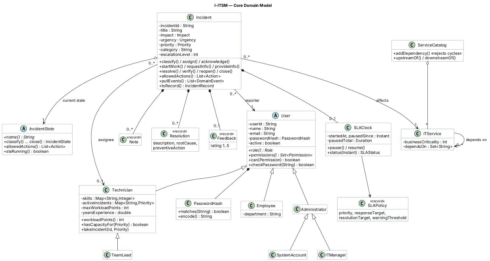

# I-ITSM Domain Layer (Java) — Member 2 Handoff

The domain layer is the "brain" of I-ITSM: every business rule, design pattern and intelligent feature lives here. It is **pure Java 17** with no Spring and no database, so it compiles and is tested on its own. The web/API layer (Member 3) and the UI (Member 1) plug into it.

## Running it

From the `backend/` folder:

| What | IntelliJ / Maven | Windows, no IDE | Mac/Linux, no IDE |
|---|---|---|---|
| Run the 3 video workflows | run `com.itsm.demo.Demo` / `mvn compile exec:java` | `run-demo.bat` | `./run-demo.sh` |
| Run the 60 tests | right-click `src/test/java` → Run / `mvn test` | `run-tests.bat` | `./run-tests.sh` |

In IntelliJ: *File → Open →* select `backend/pom.xml` → *Open as Project*. Then run `com.itsm.demo.Demo`.

## How this answers the central question

**Maintainable.** Each rule lives in exactly one class. Fields are private with no setters; an incident changes only through business methods that check permissions and legality first. One facade (`ServiceDesk`) is the only door into the domain.

**Extensible.** A new lifecycle state is one class. A new priority or assignment algorithm is one class, selectable at runtime by an admin. A new notification channel is one class. A new incident category or service is added as data by an admin, with no code change. A smarter duplicate detector plugs in behind an interface.

**Intelligent.** Explainable priority, smart technician recommendation with reasons, auto-categorization, duplicate detection, root-cause correlation over a service dependency graph, what-if blast-radius simulation, predictive SLA risk, automatic escalation, sticky reassignment on reopen, and suggested resolutions from history.

## Package map (`com.itsm.domain`)

| Package | Contents | Patterns / OOP concepts |
|---|---|---|
| `user` | `User` (abstract) → `Employee`, `Technician` → `TeamLead`, `Administrator` → `ITManager`, `SystemAccount` | Abstraction, inheritance (true is-a only), polymorphic `permissions()`, encapsulation, salted PBKDF2 hashing |
| `incident` | `Incident` aggregate; `Note`, `Resolution`, `Feedback` records | Encapsulation, composition (owns notes/resolutions/SLA clock), association (reporter, technician, service) |
| `state` | 10 lifecycle states incl. `AWAITING_INFO` and `REOPENED` | **State** pattern (states are shared singletons) |
| `priority` | `WeightedScorePriorityStrategy`, `MatrixPriorityStrategy` | **Strategy** pattern, interface |
| `assignment` | skill, load, round_robin, priority, smart | **Strategy** + **Template Method** (abstract class fixes the filter→score→sort→pick algorithm) |
| `event` | `EventBus`, `DomainEvent`, `AuditLog` | **Observer** pattern |
| `notification` | In-app, Email, SMS channels; `NotificationService` | **Observer**, **Adapter** (`SmsChannelAdapter` wraps a vendor SDK) |
| `factory` | `IncidentFactory`, `UserFactory`, `NotificationChannelFactory` | **Factory** pattern |
| `repository` | `IncidentRepository`, `UserRepository` interfaces + in-memory versions | **Repository** pattern (the contract for Member 3) |
| `escalation` | `EscalationHandler` chain, `EscalationPolicy` | **Chain of Responsibility** |
| `desk` | `ServiceDesk`, `IncidentRequest`, `SearchCriteria`, `Reports`, `SampleData` | **Facade**, **Builder** (request + search) |
| `sla` | `SLAPolicy`, `SLAPolicyBook` (per-service overrides), `SLAClock` (pause/resume) | Records, composition |
| `catalog` | `ITService`, `ServiceCatalog` (dependency graph, cycle check, BFS/DFS), `CategoryRegistry` | Collections & graph algorithms |
| `intelligence` | Duplicate detector, correlator, SLA risk, resolution suggester, what-if simulator | Interfaces Member 4 can upgrade |
| `persistence` | `StorageAdapter` (the one interface Member 3 implements), `UserRecord`, `IncidentRecord`, `ServiceRecord`, `InMemoryStorage` | Write-through persistence, records |
| `exception` | 15 specific exceptions under the `ITSMException` base, each with a code and HTTP status (incl. database and network failures) | Exception hierarchy |
| `common` | Enums, `Clock` / `FakeClock`, UTC + IST formatting, `Json` writer | Dependency inversion (testable time) |

**Design patterns: 11** (the brief requires 2) — State, Strategy ×2, Template Method, Observer, Adapter, Factory, Repository, Chain of Responsibility, Facade, Builder.

## What makes this design stand out

1. **Every decision explains itself.** Priority returns a full breakdown ("why is this P1?"); assignment returns reasons for each candidate. Both go into the audit trail.
2. **Workload is measured in points, not ticket count.** A P1 costs 8 points, a P4 costs 1, so ten printer jams don't look the same as one payment outage.
3. **The SLA clock pauses** while waiting for the reporter (AWAITING_INFO), and deadlines shift fairly.
4. **The UI never guesses which buttons to show.** `incident.allowedActions()` asks the current State object.
5. **Root-cause correlation** walks the service dependency graph: "Payment and Email are failing; both depend on SSO, which is also reported down."
6. **What-if simulation:** "if the Core Database fails, these 4 services go down, 2 of them business-critical."
7. **Dependency cycles are impossible:** the catalog rejects any edge that would create one.
8. **Predictive SLA risk** warns before the standard 75% warning ("not acknowledged, 60% of response time used").
9. **Sticky reassignment:** a reopened incident goes back to the technician who already knows it, if they have capacity.
10. **Resolutions record root cause and preventive action**, which feeds the "suggested resolution" feature.
11. **Testable time:** `FakeClock` lets the demo show breaches and escalations in seconds. All times display in UTC and IST.
12. **Survives restarts:** everything is saved through one interface and fully rebuilt at startup (tested).
13. **Production-minded details:** thread-safe facade, login lockout after 5 failed attempts, auto-close of resolved incidents after 72 h, and a failing notification channel never breaks the workflow.

## Handoff contracts

### Member 3 — Database & API (Spring Boot suggested)
- Create one `ServiceDesk` bean and call **only** its public methods from controllers. Return `incident.toMap(desk.now())` (it's JSON-ready).
- One `@RestControllerAdvice` handles every domain error:
  ```java
  @ExceptionHandler(ITSMException.class)
  ResponseEntity<Map<String,String>> handle(ITSMException e) {
      return ResponseEntity.status(e.httpStatus())
          .body(Map.of("error", e.getCode(), "message", e.getMessage()));
  }
  ```
- **Database:** implement the single interface `persistence/StorageAdapter` (save/load users, incidents, services; audit, categories and SLA policies are optional) and call `desk.attachStorage(adapter)` at startup. Everything is then saved automatically on every change and fully reloaded after a restart. Full guide, ER diagram and skeleton: `docs/DATABASE_DESIGN.md`.
- **Endpoints:** the complete list with the desk method each one calls is in `docs/API_CONTRACT.md`.
- `ServiceDesk` is thread-safe, so a single Spring bean can serve all requests.
- Call `desk.runMonitor()` every minute with `@Scheduled(fixedRate = 60000)`.
- Use `desk.login(email, password)` behind your JWT/session login endpoint (it already locks an account after 5 failed attempts).

### Member 1 — Frontend
- Build your screens now against the JSON samples in `docs/API_CONTRACT.md` (mock data), then switch to the live API when Member 3 is ready.
- `allowedActions` tells you which buttons to show; `priorityExplanation` and `assignmentReason` make good tooltips.
- Employee portal: `myIncidents`. Technician workspace: `myQueue` (most urgent first). Notification bell: `inbox`.
- Admin dashboard data: `overview`, `technicianWorkload`, `serviceAnalysis` (with live health: OPERATIONAL / DEGRADED / DOWN), `slaRisks`, `correlations`, `simulateFailure`.

### Member 4 — Intelligence & Testing
- Baselines in `intelligence/` sit behind interfaces. For example, write `TfIdfDuplicateDetector implements DuplicateDetector` and plug it in with `desk.setDuplicateDetector(...)`.
- `src/test/java` has 60 passing JUnit 5 tests, already documented for the report in `docs/TEST_CASES.md` (with a bug-resolution log). Extend it with API and integration tests.

## Priority algorithm (for the report)

```
base  = Impact (1–4) × Urgency (1–4) × Business Criticality (1–5)     max 80
boost = 1 + 0.1 × log10(affected users)                               1 user ×1.0, 1,000 users ×1.3
score = base × boost
P1 ≥ 48   P2 ≥ 24   P3 ≥ 10   else P4
```
The log boost means the number of affected users matters, but cannot by itself turn a trivial problem into a critical one. The alternative `matrix` strategy is the standard ITIL impact/urgency matrix, with a one-level bump for business-critical services.

## Diagrams for the report

All in `docs/diagrams/` as PNG (ready to paste into the report) plus `.puml` source you can edit at plantuml.com.

| File | Shows |
|---|---|
| `1-use-case.png` | Actors and what each can do |
| `2-state-diagram.png` | Incident lifecycle (State pattern) |
| `3-class-diagram-core.png` | Users, Incident, SLA, services and their relationships |
| `4-class-diagram-patterns.png` | All 11 design patterns and how ServiceDesk uses them |
| `5-sequence-report-incident.png` | Workflow 1 step by step |
| `6-architecture.png` | Layered architecture and who owns each layer |
| `7-er-diagram.png` | Suggested database schema |


